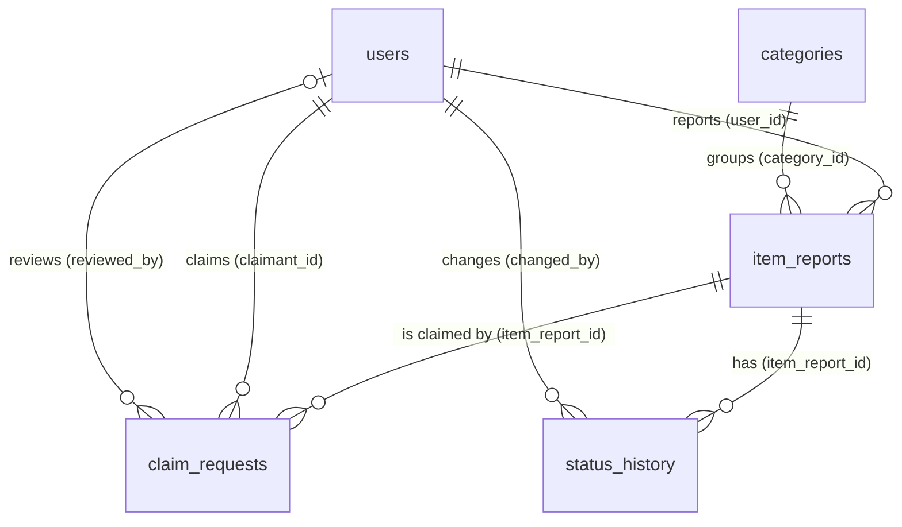

# Database design

SQLite, accessed with PDO. Every connection runs `PRAGMA foreign_keys = ON`
(see `config/database.php`). The schema is in `database/schema.sql`.

## Relationships

| Table | Purpose | Key columns |
|---|---|---|
| `users` | Students and staff | `email` UNIQUE, `password_hash`, `role` CHECK (`student`, `admin`) |
| `categories` | Item categories | `name` UNIQUE |
| `item_reports` | Lost and found reports (main CRUD table) | `user_id`, `category_id`, `report_type`, `item_name`, `description`, `location`, `date_occurred`, `image_path`, `status` |
| `claim_requests` | A student's claim on a found item | `item_report_id`, `claimant_id`, `claim_details`, `status`, `reviewed_by`, `reviewed_at`, `staff_notes` |
| `status_history` | One row per item status change | `item_report_id`, `changed_by`, `old_status`, `new_status`, `notes` |

All foreign keys use `ON DELETE RESTRICT`, so a user, category or report that is still referenced cannot be
deleted by accident. Timestamps are text in the format `YYYY-MM-DD HH:MM:SS` (Asia/Manila time); `date_occurred` is `YYYY-MM-DD`.

## Constraints that protect the rules

- `CHECK` constraints limit `role`, `report_type`, item `status` and claim `status` to the allowed values.
- Partial unique index `uq_claim_one_active_per_user`: a student can have only one **pending or approved** claim per report.
- Partial unique index `uq_claim_one_approved_per_item`: a report can have at most **one approved** claim.
- Indexes on foreign keys and on columns that are searched or filtered (`status`, `created_at`, `item_name`, ...).

The PHP code checks the same rules first and shows friendly messages; the database is the safety net.

## Item status rules

Allowed changes are defined once, in `item_status_transitions()` in `includes/reports.php`, and every change goes through
`change_item_status()`, which updates the report and writes the history row in one transaction.

Found reports:

| From | Allowed to | How it happens |
|---|---|---|
| `open` | `claim_pending` | A student submits a claim |
| `open` | `closed` | Owner or staff closes the report |
| `claim_pending` | `awaiting_handover` | Staff **approve** a claim |
| `claim_pending` | `open` | The last pending claim is rejected or withdrawn |
| `claim_pending` | `closed` | Staff close the report (pending claims are rejected) |
| `awaiting_handover` | `returned` | Staff **record the handover** |
| `awaiting_handover` | `open` | Staff revoke the approval |
| `closed` | `open` | Staff reopen |
| `returned` | (none) | Final |

Lost reports never take claims: `open` to `closed` or `returned` (staff mark it recovered), and `closed` to `open`.

## Claim status rules

`pending` to `approved`, `rejected` or `withdrawn`. Only the claimant can withdraw (while pending). Only staff approve or reject.
Approving one claim rejects the other pending claims for the same item (with a system note). Revoking an approval turns that
claim into `rejected` and reopens the report. The claim status is never copied into the item status.
